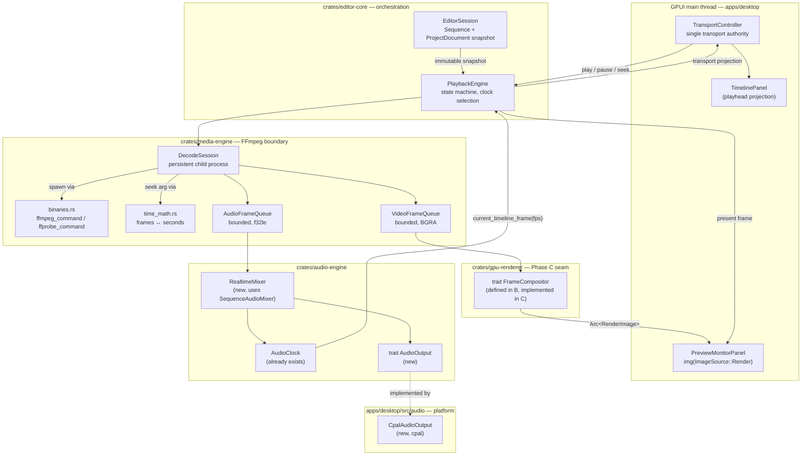

# Phase B — Real Playback Engine Design

> **Status: PROPOSED — design only. No implementation has been done.**
> `AGENTS.md` §10 requires a design and user sign-off *before* adding a new engine,
> protocol, timeline or command path. This document is that design. Nothing in this
> document should be read as a claim that Phase B code exists.
>
> | | |
> | --- | --- |
> | Date | 2026-11-12 |
> | Applies to | `NodaVideo` at commit `6391350` + the Phase A stabilization changes |
> | Authority | `AGENTS.md` (architectural contract), `docs/GPUI_KIT_GUIDELINES.md` (GPUI rules) |
> | Companion | `.workbuddy-ai/memory/2026-11-12.md` (playback/editing capability audit) |
> | Scope | Continuous playback: decode, clock, A/V sync, audio output, frame presentation |
> | Out of scope | WYSIWYG compositing, interactive drag/edge-trim, export rewrite (Phase C) |

---

## 1. Problem statement

Phase A stabilized the existing preview path but deliberately did not replace it.
The app still cannot *play* video in the NLE sense: it displays a sequence of
independently extracted still images.

Current pipeline after Phase A:

```
wall-clock tick
  → set_playhead_exact(target_frame)
  → PreviewScheduler (single-flight, coalescing)
  → MediaProcessor::render_preview
      → resolve_renderable_video_clip (one topmost clip)
      → spawn ONE ffmpeg process: -ss <t> -i <file> -frames:v 1 → JPEG on disk
      → atomic rename, fps-tagged cache key
  → PreviewMonitorPanel::set_frame(Option<PathBuf>)
  → img(path) loads and decodes the JPEG on the GPUI thread
```

Measured on this machine (macOS aarch64, FFmpeg 9.0.2, 640x360 / 24fps test clip):

| Path | Measurement | Implied ceiling |
| --- | --- | --- |
| 24 separate one-frame JPEG extractions (current path) | `0.90 s` | ~37.5 ms/frame → ~27 fps, **before** JPEG decode, compositing or audio |
| One persistent FFmpeg process, 24 frames of raw BGRA | `0.03 s` | ~1.25 ms/frame → ~800 fps |
| One persistent FFmpeg process, 240 frames scaled to 1080p BGRA | `0.34 s` | ~1.4 ms/frame |

The dominant cost is **process startup + seek + JPEG encode/decode**, not decoding.
A persistent decoder removes it.

Concrete blockers, in priority order:

1. **No audio output.** There is no `cpal`, `rodio`, ALSA, CoreAudio or SDL2
   dependency anywhere in the workspace. `crates/audio-engine` provides mixing
   primitives (`AudioClock`, `SequenceAudioMixer`, `AudioBuffer`, `AudioMeter`) but
   is used only from `#[cfg(test)]` code in `apps/desktop/src/main.rs`. Playback is
   silent.
2. **No A/V sync.** There is no shared clock between video presentation and any
   audio device. Phase A's wall-clock loop is a video-only clock.
3. **One process + one JPEG per frame.** Cannot sustain sequence fps at production
   resolutions, and cannot be fixed by more scheduling work.
4. **Preview and export disagree.** Preview resolves one topmost video clip;
   export builds a separate FFmpeg filtergraph. Neither renders transitions,
   titles, captions, transforms or per-clip audio parameters. What you see is not
   what you get.
5. **Transport state is duplicated** across `TimelinePanel.selection.playhead_frame`,
   `PreviewMonitorPanel.is_playing`, `WorkspaceLayoutState.is_playing`, and
   `EditorSession.playback` / `PlaybackController` (currently unused).
6. **No GPU texture path.** `PreviewMonitorPanel` only holds `Option<PathBuf>` and
   renders `img(path)`.

---

## 2. Goals and non-goals

### Goals (B)

- G1. Sustain playback at the **sequence frame rate** (24/25/30/60 fps) for a
  realistic multi-track project, with bounded memory.
- G2. **Audible** audio, mixed from audio tracks with mute/solo/gain/pan and
  aligned to timeline frames.
- G3. **A/V sync with audio as master**, with a defined fallback when no device or
  no audio track exists.
- G4. **Frame-accurate seeking** and scrubbing, including backward seeks.
- G5. Present frames **in memory**, with no disk round-trip per frame.
- G6. Keep a **single compositor seam** so preview and export can converge in
  Phase C without redesigning playback.
- G7. Preserve every `AGENTS.md` invariant (§3 below), and keep all heavy work off
  the GPUI thread.
- G8. Degrade gracefully: missing FFmpeg, unsupported codec, no audio device, or
  decode underrun must fall back to the Phase A still-frame path, never crash.

### Non-goals (B) — explicitly deferred

- Compositing multiple visible video tracks, transitions, titles, captions,
  transforms or effects → **Phase C**.
- Rewriting `export_sequence` to share the render graph → **Phase C** (but B
  defines the seam).
- Interactive clip dragging, edge-trim handles, ripple UI, multi-select → **Phase C**.
- Reverse playback, variable speed beyond `1.0`, frame blending, HDR, 10-bit
  pipelines → later.
- GPU (wgpu) decode or zero-copy NV12 textures → later; B uses CPU BGRA frames.

---

## 3. Non-negotiable constraints inherited from `AGENTS.md`

| # | Constraint | How this design satisfies it |
| --- | --- | --- |
| C1 | Two separate engines; editor owns all project state | The playback engine is a **pure reader** of immutable `Sequence` + `ProjectDocument` snapshots. It never mutates either. |
| C2 | One command system; every state mutation through `EditorCommand` | Playback mutates **no project state**. Transport (playhead, playing, loop) is ephemeral view state, not project state; see D4 for the required sign-off on this interpretation. |
| C3 | Time as integer frames / rational time, never float seconds in the model | All PTS are `i64` timeline frames or `i64` audio samples. Float seconds exist **only** inside `media-engine/src/time_math.rs` at the FFmpeg CLI boundary. |
| C4 | FFmpeg for all decoding/encoding; do not implement codecs | Persistent FFmpeg child processes emitting `-f rawvideo -pix_fmt bgra` and `-f f32le`. No libav FFI, no custom decoders. |
| C5 | Heavy work off the UI thread | Decode threads, audio callback thread, and a presenter that only swaps an `Arc<RenderImage>` on the GPUI thread. |
| C6 | No second timeline | The engine consumes the one `Sequence`. It has no timeline, no clip list, no edit operations of its own. |
| C7 | No platform-specific APIs in `crates/*` | `AudioOutput` is a trait in `audio-engine`; the concrete `cpal` backend lives in `apps/desktop`. |
| C8 | SQLite is a cache/index, not project state | Decoded frames live in bounded in-memory queues. No new database. |
| C9 | Pin GPUI versions; verify APIs against pinned crate source | The `RenderImage` path in §5.7 was verified against the local `gpui-pre 0.3.11` source. |
| C10 | Dependencies to core crates need justification | `cpal` and an SPSC ring buffer go into `apps/desktop` only, with justification recorded in the commit (see §9 R5). |

---

## 4. Proposed architecture

### 4.1 Component view



### 4.2 Crate boundary changes (requires sign-off)

| Crate | Change | Boundary impact |
| --- | --- | --- |
| `crates/media-engine` | Add `decode.rs` (`DecodeSession`, `VideoFrame`, `AudioFrame`), `frame_queue.rs` | Purely additive; still owns all FFmpeg process handling. Still must not define timeline semantics. |
| `crates/audio-engine` | Add `output.rs` (`AudioOutput` trait), `realtime.rs` (`RealtimeMixer`) | Purely additive; still must not mutate project state. |
| `crates/editor-core` | Activate the existing but unused `PlaybackController`; add `PlaybackEngine` + `TransportState` | `editor-core` keeps its "orchestration" role; no protocol adapters. |
| `crates/gpu-renderer` | Add `FrameCompositor` **trait only** in B | No implementation in B; keeps the WYSIWYG seam honest. |
| `apps/desktop` | `audio/cpal_output.rs`, `playback/presenter.rs`; `PreviewMonitorPanel` accepts `Arc<RenderImage>` | Platform specifics and GPUI views stay in the app, per C7. |

**No new crate is proposed.** A separate `playback-engine` crate would split clock
ownership from `EditorSession` and would require a §3 layout change; the
`editor-core` orchestration role already covers it. If the user prefers a new
crate, that is decision D1.

---

## 5. Detailed design

### 5.1 Core types (sketches, not final signatures)

```rust
// crates/media-engine/src/decode.rs
/// A decoded, presentation-ready video frame. `pts_frames` is in SEQUENCE frames,
/// never seconds. `data` is BGRA, row-major, width*height*4 bytes, and is OWNED so
/// it can be moved straight into `image::RgbaImage::from_raw` with no copy.
#[derive(Debug, Clone)]
pub struct VideoFrame {
    pub pts_frames: i64,
    pub width: u32,
    pub height: u32,
    pub data: Vec<u8>,
}

/// Decoded audio in the engine's canonical format: 48 kHz, stereo, interleaved f32.
#[derive(Debug, Clone)]
pub struct AudioFrame {
    pub pts_samples: i64,   // absolute sample index, not a timestamp float
    pub samples: Vec<f32>,
}

pub enum StreamKind { Video { width: u32, height: u32 }, Audio }

/// One long-lived FFmpeg child process for one stream of one asset.
/// Built exclusively via `binaries::ffmpeg_command()`.
pub struct DecodeSession {
    pub asset_id: AssetId,
    pub kind: StreamKind,
    // child: Child + stdout reader thread, bounded channel to the queue
}

impl DecodeSession {
    /// Restart the process at `source_frame`, decoding from the nearest keyframe
    /// and discarding frames until the exact PTS is reached.
    pub fn seek(&mut self, source_frame: i64, sequence_fps: FrameRate,
                asset_fps: FrameRate) -> Result<(), MediaEngineError>;
}
```

```rust
// crates/audio-engine/src/output.rs
/// Implemented in apps/desktop, never in crates/* (constraint C7).
/// `write` is called from a real-time audio callback: it MUST NOT allocate,
/// lock, block, or touch the filesystem.
pub trait AudioOutput: Send {
    fn configure(&mut self, format: AudioFormat) -> Result<(), AudioError>;
    fn write_samples(&mut self, out: &mut [f32]) -> usize;
    fn latency_samples(&self) -> u64;
    fn play(&mut self) -> Result<(), AudioError>;
    fn pause(&mut self) -> Result<(), AudioError>;
}
```

```rust
// crates/gpu-renderer (trait only in B)
/// The seam that makes preview and export converge in Phase C.
/// B ships `SingleClipCompositor`; C ships `WgpuCompositor` and reuses the
/// same `ComposeRequest` for offline export rendering.
pub trait FrameCompositor: Send + Sync {
    fn compose(&self, req: ComposeRequest<'_>) -> Result<ComposedFrame, RenderError>;
}

pub struct ComposeRequest<'a> {
    pub sequence: &'a Sequence,
    pub project: &'a ProjectDocument,
    pub timeline_frame: i64,
    pub layers: &'a [VideoFrame],   // one per visible video track, bottom-to-top
}
```

```rust
// crates/editor-core — the single transport authority
pub struct TransportState {
    pub playhead_frame: i64,
    pub is_playing: bool,
    pub is_looping: bool,
    pub speed: f32,               // B: 1.0 only
    pub fps: FrameRate,
}
```

### 5.2 Decode sessions

One `DecodeSession` per **active stream**, created lazily and kept alive across
consecutive frames of the same clip:

```
ffmpeg -v error
       -ss <source_seconds>            # from time_math::frames_to_seconds
       -i <asset.file_path>
       -map 0:v:0
       -vf scale=<display_w>:<display_h>
       -pix_fmt bgra -f rawvideo -     # stdout, no JPEG, no disk
```

Audio variant:

```
ffmpeg -v error -ss <source_seconds> -i <asset.file_path>
       -map 0:a:0 -vn -ac 2 -ar 48000 -f f32le -    # stdout
```

Key decisions:

- **Decode at display size, not sequence size.** A 1080p BGRA frame is
  `1920 * 1080 * 4 = 8,294,400 B ≈ 7.9 MiB`. Decoding into the actual preview
  widget bounds (e.g. 960x540 → ~2.0 MiB) cuts queue memory 4x. The display size
  is part of the decode-session key; resizing the panel invalidates sessions.
- **BGRA specifically.** Verified in pinned `gpui-pre 0.3.11`: `RenderImage` is
  documented as BGRA (`src/assets.rs:42`), and `img.rs:678,710` and
  `svg_renderer.rs:213` explicitly convert RGBA→BGRA before
  `RenderImage::new`. Emitting `bgra` from FFmpeg avoids a per-frame swizzle.
- **`-ss` before `-i` for speed, plus decode-and-discard** to land on the exact
  frame. FFmpeg's fast seek lands on a keyframe; the session drops frames whose
  PTS is below the target. `-ss` after `-i` is exact but re-decodes from the
  start; it remains the fallback for short clips where that is cheaper.
- **Retiming stays in `time_math.rs`.** `timeline_to_source_frame` and
  `retiming_factor` (added in Phase A) are the only frame↔frame conversions;
  `frames_to_seconds` / `format_seconds` are the only frame↔second conversions,
  used solely to build the `-ss` argument.
- **Prefetch the next clip** on the same track so a clip boundary does not stall.
  At most `N_video + 1` and `N_audio + 1` sessions; the oldest idle session is
  dropped when the cap is hit.
- **All FFmpeg processes are spawned through `binaries::ffmpeg_command()`** —
  never `Command::new("ffmpeg")`. This preserves the Phase A A1 fix for
  Finder/Explorer-launched GUI processes.

### 5.3 Queues, backpressure, memory budget

`VideoFrameQueue` and `AudioFrameQueue` are bounded SPSC channels owned by the
playback engine. Producers **block or drop-by-generation**, never allocate
unboundedly.

| Queue | Bound | Worst-case memory |
| --- | --- | --- |
| Video (per video track, 960x540 BGRA) | 8 frames | `8 * 2.0 MiB = 16 MiB` per track |
| Video (4 tracks) | 8 frames each | ~64 MiB |
| Audio (48 kHz stereo f32) | 250 ms | `48_000 * 2 * 4 * 0.25 ≈ 96 KiB` |
| Presenter | 1 `Arc<RenderImage>` + 1 in-flight | ~4 MiB |

Hard cap: **128 MiB** for preview buffers. If exceeded, the engine drops the
oldest non-displayed video frames and reports a `DecodeUnderrun` metric; it does
not grow the queue.

**Backpressure rule:** when the video queue is full, the decode thread waits on a
condvar. When the audio queue is full, the audio decode thread waits too. Audio
is never dropped to "catch up" — dropping audio is audible; dropping a stale
video frame is not.

### 5.4 Threading and ownership

| Thread | Owns | Must not do |
| --- | --- | --- |
| GPUI main | `EditorSession`, `TransportController`, panel views, `Arc<RenderImage>` swap, `cx.notify()` | decode, file I/O, blocking reads |
| Decode thread(s), one per `DecodeSession` | FFmpeg child stdout reader, queue producer | touch GPUI entities, mutate `Sequence` |
| Audio callback (cpal) | `RealtimeMixer` scratch buffers, `AudioOutput`, `AudioClock::advance_samples` | allocate, lock, log, block, call into GPUI |
| Playback coordinator (background task) | clock selection, queue arbitration, session lifecycle, `seek` | mutate project state |

The audio callback communicates its position via a single `AtomicU64`
(`current_sample`), mirroring `AudioClock::current_sample` which already exists.
The GPUI thread reads that atomic — no mutex, no priority inversion.

A `Sequence` / `ProjectDocument` snapshot is taken on the UI thread (as Phase A's
`spawn_preview_task` already does) and passed by value. An edit during playback
increments a snapshot generation; the engine finishes the current frame, then
restarts decode sessions for affected clips. The engine never observes a
partially applied edit.

### 5.5 Clock and A/V sync

**Audio is master** whenever an audio device and at least one enabled audio clip
exist. This is standard NLE practice: the audio device clock is the only clock
that cannot drift relative to what the user hears.

```
audio callback writes N samples
  → AudioClock::advance_samples(N)
  → current_sample (AtomicU64)
  → current_timeline_frame(fps)          [already in clock.rs]
  → presenter selects newest VideoFrame with pts_frames <= clock_frame
  → drops all older queued frames
  → AudioClock::drift_frames(visual_frame, fps)  [already in clock.rs]
      |drift| <= 1 frame  → present
      |drift| >  1 frame  → skip/repeat frames, record metric
```

**Fallback — video master:** no audio device, all audio tracks muted, or a
video-only sequence. Use the Phase A wall-clock anchor (`Instant` + sequence fps),
which already avoids drift and overshoot. Switching masters is only allowed while
paused, so a mid-playback device loss pauses playback rather than jumping.

**Playhead is a projection of the master clock**, not a counter incremented per
tick. `TransportState.playhead_frame` is updated from `current_timeline_frame`;
the timeline UI observes it. This removes the duplicate sources of truth (§1 #5)
without touching project state.

**End of sequence:** stop at `last_playable_frame()` (the Phase A A3 rule),
flush the audio queue, pause `AudioOutput`, set `is_playing = false`. Never step
past the exclusive duration into a black frame.

### 5.6 Seeking

`seek(target_frame)` is atomic from the UI's point of view:

1. Pause `AudioOutput`; set `is_playing = false` internally.
2. Flush video/audio queues; invalidate all `DecodeSession`s for clips that do
   not contain `target_frame`.
3. Compute source frames with `timeline_to_source_frame(clip, target_frame,
   asset_fps, sequence_fps)`; restart remaining sessions with the corresponding
   `-ss`.
4. Decode-and-discard until `pts_frames == target_frame`; present exactly one
   frame, *even while paused*.
5. Set `AudioClock::seek_to_frame(target_frame, fps)` (already in `clock.rs`).
6. Resume if playback was active before the seek.

Scrubbing reuses `PreviewScheduler` (Phase A A2) to coalesce bursts: only the
first and last requested frames actually trigger a seek. This is why A2 is a
prerequisite for B, not throwaway work.

### 5.7 Presenting frames in GPUI (verified against pinned source)

`gpui-pre 0.3.11` supports in-memory images without a disk round-trip:

```rust
use gpui_kit::{ImageSource, RenderImage, img};   // gpui_kit also aliases itself as `gpui`
use image::{Frame, RgbaImage};
use smallvec::SmallVec;
use std::sync::Arc;

// `frame.data` is the BGRA Vec<u8> read from FFmpeg's rawvideo stdout. It is
// MOVED into the image buffer, so there is no per-frame memcpy.
let buffer = RgbaImage::from_raw(frame.width, frame.height, frame.data)
    .expect("validated width * height * 4");
let render_image = Arc::new(RenderImage::new(SmallVec::from_const([Frame::new(buffer)])));
let element = img(ImageSource::Render(render_image)).size_full();
```

Verified facts from the pinned crate:

- `gpui-kit-0.9.0/src/lib.rs:101,117` — `pub use ::gpui::*;` and
  `pub use crate as gpui;`. `gpui_kit` is the sole dependency of
  `apps/desktop`; there is no separate `gpui` crate entry.
- `src/elements/img.rs:42-50` — `ImageSource::Render(Arc<RenderImage>)` exists.
- `src/assets.rs:61` — `RenderImage::new(data: impl Into<SmallVec<[Frame; 1]>>)`
  is public and generates a unique `ImageId`.
- `src/assets.rs:42` — `RenderImage` is BGRA; `img.rs:678,710` and
  `svg_renderer.rs:213` perform RGBA→BGRA conversion before construction.
- `img.rs:551,571` — `Render` sources bypass the asset loader/cache entirely.

**Dependency consequence:** `RenderImage::new` is typed over `image::Frame` and
`smallvec::SmallVec`, and neither `image` nor `smallvec` is currently a direct
dependency of `apps/desktop` (`image` is only a workspace-level dependency).
B must add both as direct `apps/desktop` dependencies with the §9 justification,
or expose a small `into_render_image` helper from a crate that already owns them.
This is decision **D7** in §10.

`PreviewMonitorPanel` gains `current_frame: Option<Arc<RenderImage>>` alongside
its existing `current_frame_path: Option<PathBuf>`. **The path field stays** as
the Phase A fallback (§5.10), and `set_frame` (added in A5) gains a sibling
`set_render_image`. Rendering prefers `current_frame` when present.

**Open item (R1):** a new `RenderImage` per frame gives every frame a new
`ImageId`, so GPUI's image cache will allocate a new GPU texture per frame. That
may churn VRAM. B should measure this; if it is a problem, the fallback is to
encode a single in-memory PNG/BMP per frame via `Image::from_bytes` (no disk, but
CPU encode) or to move to a wgpu-backed custom element in Phase C. This is
explicitly a measurement task, not a guess.

### 5.8 Audio path

- `RealtimeMixer` (new, in `audio-engine`) pulls `AudioFrame`s from each audio
  track's queue for the sample window requested by the callback, and reuses
  existing `SequenceAudioMixer`, `db_to_linear`, `pan_to_stereo_gains`,
  solo/mute gating and `AudioMeter`.
- Timeline→sample conversion already exists:
  `timeline_frame_to_audio_sample` / `audio_sample_to_timeline_frame` /
  `samples_per_video_frame` in `buffer.rs`. No new float-second time model.
- `CpalAudioOutput` in `apps/desktop/src/audio/` implements `AudioOutput` behind
  a trait object injected at startup. This satisfies C7 (no platform-specific
  APIs in `crates/*`) and keeps `crates/audio-engine` testable without hardware.
- A `NullAudioOutput` and a `MockAudioOutput` allow CI to exercise sync logic
  with no sound card — matching `AGENTS.md` §9's "CI must not require live
  logins or network access", extended here to audio hardware.
- Device sample rate may differ from 48 kHz. `AudioOutput::configure` reports the
  device rate; the mixer resamples with a documented, bounded polyphase/linear
  stage, or FFmpeg is re-invoked with `-ar <device_rate>` for the audio sessions.
  Preferred: re-invoke FFmpeg at the device rate, so no in-process resampler is
  needed. Decision D3.

### 5.9 Error handling and graceful degradation

| Condition | Behaviour |
| --- | --- |
| FFmpeg/FFprobe missing | `MediaEngineError::FfmpegNotFound` from `binaries.rs`; surface the `NODAVIDEO_FFMPEG` hint in the status bar. No panic. |
| Unsupported / corrupt clip | `DecodeSession` fails; that track is skipped, other tracks keep playing; visible badge on the clip. |
| No audio device | Video-master fallback (§5.5); status bar explains audio is unavailable. |
| Decode underrun | Hold the last presented frame; increment a dropped-frame metric; never show black. |
| Preview panel resized | Invalidate decode sessions (display-size key changed); keep the last frame on screen during restart. |
| Any engine failure | Fall back to `MediaProcessor::render_preview` (Phase A JPEG path) and `PreviewScheduler`. The user keeps a working still-frame preview. |

### 5.10 Relationship to export / WYSIWYG seam

B defines `FrameCompositor` and ships only `SingleClipCompositor`, whose behaviour
matches today's `resolve_renderable_video_clip` (topmost renderable video clip,
overlays skipped rather than blanking the preview — the A5 rule).

Export keeps using `export_sequence`'s FFmpeg filtergraph in B. **Known and
documented:** preview and export still disagree on transitions, titles, captions
and transforms. Phase C replaces both with one `RenderGraph` that emits
`ComposeRequest`s for preview (realtime) and export (offline). Defining the trait
now prevents a third rendering path from being invented later.

---

## 6. Transport state consolidation

B introduces one `TransportState` in `EditorSession`, owned by
`TransportController`. The existing `PlaybackController` in
`crates/editor-core/src/playback.rs` is currently unused; B activates it rather
than adding a parallel controller.

| Today | After B |
| --- | --- |
| `TimelinePanel.selection.playhead_frame` | projection, updated from `TransportState` |
| `PreviewMonitorPanel.is_playing` | projection |
| `WorkspaceLayoutState.is_playing` | projection |
| `EditorSession.playback` / `PlaybackController` | **single authority** |

Playhead and transport are **not** `EditorCommand` variants: `EditorCommand::apply`
takes `&mut Sequence` and participates in undo/redo, and undoing a playhead move
is not meaningful. This is an interpretation of `AGENTS.md` §2 ("every state
mutation") that must be confirmed — see D4. If the user wants playhead moves in
the command history, B will add a `SeekPlayhead` variant instead; that changes
the command surface and requires an `AGENTS.md` §6 update.

Agents and MCP tools reach transport only through typed operations
(`render_preview`, `seek`), never by touching panel fields. The playback engine
itself never mutates `Sequence` or `ProjectDocument`.

---

## 7. Migration plan (each step independently verifiable)

| Step | Deliverable | Acceptance test |
| --- | --- | --- |
| **B0** | `docs/PLAYBACK_ENGINE_DESIGN.md` + `AGENTS.md` sync + sign-off on D1–D7 | This document approved; no code changed. |
| **B1** | `AudioOutput` trait, `NullAudioOutput`, `MockAudioOutput`, `CpalAudioOutput` in `apps/desktop` | A 440 Hz sine generated by `SineToneSource` (already in `audio-engine`) is audible through the device; `cargo test` passes in CI with `NullAudioOutput`. |
| **B2** | `DecodeSession` + raw BGRA/f32le stdout parsing in `media-engine` | Unit test: decode N known frames from a generated test clip, assert exact PTS sequence and `width*height*4` byte counts; backward seek lands on the exact frame. |
| **B3** | Bounded queues + `FrameCompositor` trait + `SingleClipCompositor` | Unit tests for queue bounds, drop-oldest, generation invalidation, and "queue full never grows past cap". |
| **B4** | `PlaybackEngine` + `TransportState` consolidation; audio-master clock | Deterministic test with `MockAudioOutput`: after simulating 48,000 samples at 24 fps, playhead is exactly frame 24, and `drift_frames` stays within ±1 for 10 s of simulated playback. |
| **B5** | `RenderImage` presentation in `PreviewMonitorPanel`; wire into GPUI | Manual smoke: press Play, video moves continuously at sequence fps with audio; scrub is immediate; no disk JPEG churn during playback. |
| **B6** | Graceful degradation, metrics, docs update | Kill/disable FFmpeg, remove audio device, corrupt a clip: app stays responsive and falls back to the Phase A still-frame path. |

B1–B4 are pure-logic work and land with unit tests. B5 is the first step that
requires a GUI smoke test. No step changes `EditorCommand` unless D4 decides so.

---

## 8. Test strategy

`AGENTS.md` §9 requires an acceptance test with every milestone and forbids CI
from depending on live logins or network. Extended here:

- **Pure state machines, no hardware:** clock arbitration, queue bounds, seek
  generation invalidation, coalescing (`PreviewScheduler` already has these
  tests). All run headless in CI.
- **Fixture-based decode:** a tiny generated MP4 committed as a test fixture (or
  generated by a test helper) with known frame PTS; CI needs FFmpeg but no
  network and no audio device — decode to memory only.
- **`MockAudioOutput`** drives the clock deterministically; no sound card.
- **`NullAudioOutput`** verifies the video-master fallback.
- **Existing gates remain:** `cargo fmt --all -- --check`,
  `cargo clippy --workspace --all-targets -- -D warnings`,
  `cargo test --workspace`, plus a GUI smoke test that is **manual** and never a
  CI gate.

Repo-specific gotcha discovered in Phase A: because `apps/desktop` does
`use gpui_kit::*;`, GPUI's `#[gpui::test]` proc-macro is re-exported under the
bare name `test`. Any `#[cfg(test)] mod tests` that uses `use super::*;` must
write `#[core::prelude::v1::test]` (as `main.rs` already does), otherwise
`#[test]` resolves to the GPUI wrapper, recurses, and crashes rustc with SIGBUS.
All Phase B unit tests must follow this convention.

---

## 9. Risks and open questions

| # | Risk / question | Mitigation / proposed default |
| --- | --- | --- |
| R1 | `RenderImage` per frame allocates a GPU texture per `ImageId` → VRAM churn | Measure in B5 (§5.7). Fallback: in-memory `Image::from_bytes` or a wgpu custom element in Phase C. |
| R2 | FFmpeg `-ss` before `-i` is keyframe-approximate | Decode-and-discard to exact PTS; add a regression test for backward seeks. |
| R3 | Audio callback must never allocate or lock | Preallocated scratch buffers, SPSC ring buffer, `AtomicU64` clock, no logging in the callback. |
| R4 | Variable-frame-rate (VFR) sources: PTS may not map 1:1 onto sequence frames | Force CFR at the decoder boundary with an `fps` filter (as export already does) and treat PTS as integer sequence frames. Native VFR conforming is out of B scope; add a fixture-based regression test. |
| R5 | New dependencies (`cpal`, SPSC ring buffer) | Add to `apps/desktop` only, with justification in the commit per `AGENTS.md` §9. Prefer `std::sync::mpsc::try_recv` + preallocated buffers first; only add `ringbuf` if glitches are measured. |
| R6 | Device sample rate ≠ 48 kHz | Preferred: re-invoke FFmpeg audio decode at device rate (D3). |
| R7 | Preview at display resolution differs from export resolution | Documented as a deliberate preview proxy; `ComposeRequest` carries the target size so Phase C's offline render can request full res. |
| R8 | Multiple visible video tracks | B composites only the topmost renderable clip (`SingleClipCompositor`). Full layering is Phase C. This must stay visible in `AGENTS.md` M3 status. |
| R9 | Phase A still-frame path and B engine coexisting during migration | Both behind the same `PreviewScheduler`; explicit fallback switch (§5.9); remove the JPEG path only after B6 passes. |

---

## 10. Decisions required from the user (sign-off checklist)

| # | Decision | Proposed default |
| --- | --- | --- |
| **D1** | New `playback-engine` crate, or orchestration inside `editor-core`? | **Inside `editor-core`** (no new crate, no §3 layout change). |
| **D2** | Audio backend library | **`cpal`**, implemented only in `apps/desktop`. |
| **D3** | Device sample-rate mismatch | **Re-invoke FFmpeg at the device rate**, no in-process resampler. |
| **D4** | Is transport state (playhead/playing/loop) outside `EditorCommand`? | **Yes** — ephemeral view state, not project state; no `SeekPlayhead` command variant. Requires explicit agreement because `AGENTS.md` §2 says "every state mutation". |
| **D5** | Is "audio is master" acceptable, with wall-clock fallback? | **Yes.** |
| **D6** | Approve B1–B6 scope, with compositing/export convergence deferred to Phase C? | **Yes.** |
| **D7** | How to supply `image::Frame` / `SmallVec` for `RenderImage::new`? | **Add `image` and `smallvec` as direct `apps/desktop` dependencies** with a §9 justification, keeping them out of `crates/*`. Alternative: an `into_render_image` helper in a crate that already owns them. |

Until D1–D7 are confirmed, **no Phase B code should be written**. Phase A is
complete and independently shippable.

---

## 11. Projected files (NOT yet created/modified for B)

```
crates/media-engine/src/decode.rs            (new)
crates/media-engine/src/frame_queue.rs       (new)
crates/audio-engine/src/output.rs            (new)
crates/audio-engine/src/realtime.rs          (new)
crates/gpu-renderer/src/compositor.rs        (new; trait only)
crates/editor-core/src/playback.rs           (activate + extend)
apps/desktop/src/audio/cpal_output.rs        (new)
apps/desktop/src/playback/presenter.rs       (new)
apps/desktop/src/workspace/panels/preview_monitor.rs (Arc<RenderImage> path)
apps/desktop/src/workspace/mod.rs            (engine wiring)
apps/desktop/Cargo.toml                      (cpal, image, smallvec, conditional ring buffer)
AGENTS.md                                   (milestone + layout + crate table)
crates/media-engine/README.md                (decode module)
crates/audio-engine/README.md                (new or created)
```

## 12. Verification contract for B0 (this step)

This design step changed only documentation. The Phase A code it describes is
verified by:

```
cargo fmt --all -- --check                          → clean
cargo test --workspace                              → 123 passed, 0 failed
cargo clippy --workspace --all-targets -- -D warnings → clean
cargo build --workspace                             → success (95 MB debug binary)
```
